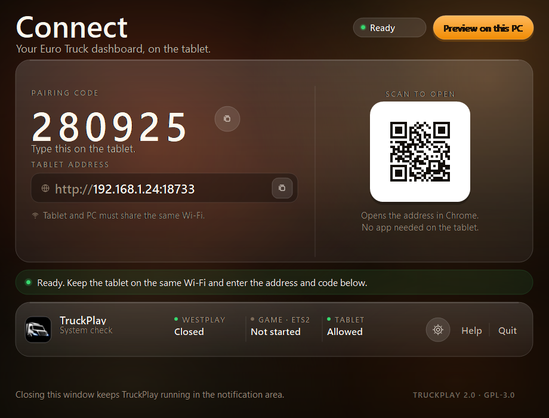
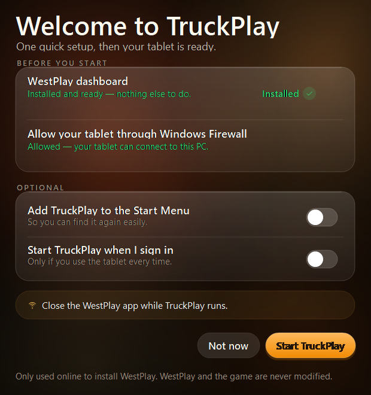
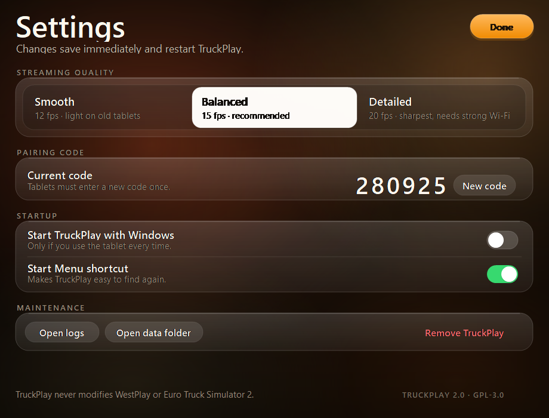
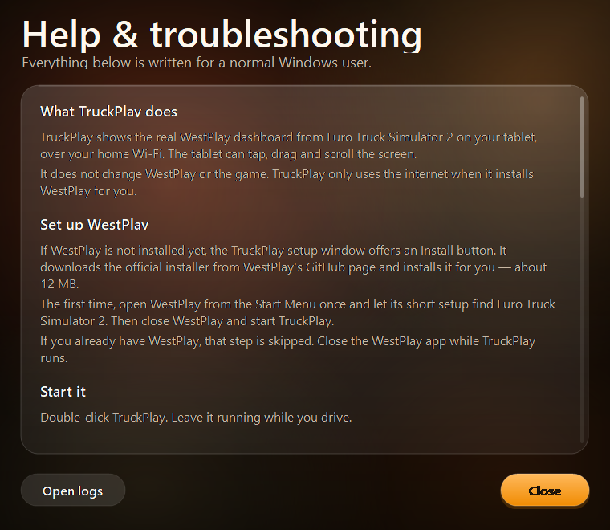

<h1 align="center">TruckPlay</h1>

<p align="center">
  <b>Your Euro Truck Simulator 2 dashboard on an old tablet — one window, no command line.</b>
</p>

<p align="center">
  <a href="https://github.com/hey-sarthak/TruckPlay/raw/refs/heads/main/TruckPlay.exe"></a>
  
  
  
  
  
</p>

<p align="center">
  <a href="#english">🇬🇧 English</a> ·
  <a href="#chinese">🇨🇳 简体中文</a> ·
  <a href="#hindi">🇮🇳 हिन्दी</a> ·
  <a href="#spanish">🇪🇸 Español</a> ·
  <a href="#french">🇫🇷 Français</a> ·
  <a href="#german">🇩🇪 Deutsch</a> ·
  <a href="#portuguese">🇧🇷 Português</a> ·
  <a href="#russian">🇷🇺 Русский</a> ·
  <a href="#japanese">🇯🇵 日本語</a> ·
  <a href="#korean">🇰🇷 한국어</a> ·
  <a href="#arabic">🇸🇦 العربية</a>
</p>

<p align="center">
  
</p>

TruckPlay runs the [WestPlay](https://github.com/enes-less/WestPlay) dashboard for **Euro Truck Simulator 2**
on your PC and shows it on a tablet over your home Wi-Fi. The tablet can tap, drag and scroll it, so it
behaves like a second screen for the truck. There is **no app to install on the tablet** — it simply opens
in Chrome.

---

<a id="english"></a>

## 🇬🇧 English

### ✨ What you get

| Feature | What it does |
| --- | --- |
| 🖥️ **One window** | The tablet address, a large pairing code, a scan-to-open QR code and live status — all on one screen. |
| 🧩 **Installs WestPlay for you** | If WestPlay is missing, one click downloads the official installer from WestPlay's GitHub releases and runs it. You are asked first; nothing happens silently. |
| 📱 **No tablet app** | The tablet opens a normal web page in Chrome. Nothing to sideload, no app store, no extra account. |
| 🔗 **Scan, then drive** | Point the tablet camera at the QR code, or type the address and the six-digit code once. The tablet remembers it. |
| 🛡️ **One-click firewall** | A single button lets your tablet through Windows Firewall — the number one reason streaming "does not work". |
| 🪶 **Tiny and quiet** | A single ~11 MB `.exe`. No installer, no services, no background updater. Closing the window keeps it in the notification area. |
| 💬 **Plain language** | Messages and a built-in Help window are written for a normal person, not for a log reader. |

### 📸 Screenshots

| Setup — first run | Settings |
| --- | --- |
|  |  |
| **Help** | **Main window** |
|  |  |

> Screenshots use the example address `192.168.1.24`. Your PC will show its own local address.

### 🚀 Quick start

1. **Download** [`TruckPlay.exe`](https://github.com/hey-sarthak/TruckPlay/raw/refs/heads/main/TruckPlay.exe)
   directly from this repository. The current repository does not publish a separate ZIP or GitHub Release.
2. **Double-click `TruckPlay.exe`.**
   If Windows shows *"Windows protected your PC"*, choose **More info → Run anyway** only if
   you downloaded the file from this official repository and trust it. The launcher is not signed
   with a paid code-signing certificate.
3. **In the setup window:**
   - If WestPlay says **Not installed**, click **Install** (about 12 MB) and wait for **Installed**.
     TruckPlay downloads the official WestPlay installer only after you click the button.
     The very first time, open WestPlay once from the Start Menu so its setup can find Euro Truck
     Simulator 2, then close it again.
   - Click **Allow** when the firewall row appears.
   - Click **Start TruckPlay**.
4. **On the tablet:** open Chrome, type the address TruckPlay shows (for example
   `http://192.168.1.24:18733`), then the six-digit code from the window. Or scan the QR code.

Next time: open TruckPlay, start the game, drive. 🚚

### 📋 Requirements

| Need | Detail |
| --- | --- |
| 🪟 **Windows** | Windows 10 or Windows 11, 64-bit |
| 🎮 **Game** | Euro Truck Simulator 2, with a truck that has a compatible dashboard screen |
| 📶 **Network** | PC and tablet on the same Wi-Fi network |
| 🌐 **Tablet browser** | Chrome, Edge, Safari or any modern browser — no app needed |

WestPlay does **not** need to be installed first; TruckPlay offers to install it.

### 🩺 Troubleshooting

<details>
<summary><b>The tablet cannot open the page</b></summary>

- Make sure both devices are on the **same Wi-Fi**. Guest networks and "isolation" modes block this.
- Click **Allow** in the firewall row (or **Settings → Open logs** to see what happened).
- Some routers isolate Wi-Fi clients by default — turn off *AP isolation* / *client isolation*.
</details>

<details>
<summary><b>The address keeps changing</b></summary>

The PC gets its address from the router. Reserve a fixed address for the PC in the router settings, or
simply scan the QR code each time — that always uses the current address.
</details>

<details>
<summary><b>The dashboard is empty or black</b></summary>

Start Euro Truck Simulator 2 and load a save. WestPlay only shows data while the game is running. If you
just installed WestPlay, open it once from the Start Menu so it can find the game.
</details>

<details>
<summary><b>Windows SmartScreen blocked the download</b></summary>

Only continue if you trust the file and downloaded it from this repository. The launcher is not
signed with a paid code-signing certificate. The repository includes `SHA256.txt` for checksum
verification; it is not a GitHub Release asset.
</details>

### 🔒 Privacy and safety

- 🚫 No accounts, no analytics, no telemetry, no ads.
- 🌐 TruckPlay downloads WestPlay's official installer only after you click **Install**.
- 🧰 TruckPlay does not modify WestPlay, Euro Truck Simulator 2 or your save games.
- 🔐 The tablet connection is served by the built-in host over your local network.

### 🧱 How it works

```
┌──────────────┐   local Wi-Fi   ┌────────────────┐   loopback   ┌──────────┐
│   Tablet     │ ──────────────► │  TruckPlay.exe │ ───────────► │ WestPlay │
│  (Chrome)    │ ◄────────────── │  built-in host │ ◄─────────── │  @ PC    │
└──────────────┘                 └────────────────┘              └──────────┘
```

`TruckPlay.exe` carries a small Rust host that serves the WestPlay dashboard on a local port and proxies
it to the tablet. The launcher is a hand-painted WinForms app with no third-party UI libraries.

### 🛠️ Source and build information

This GitHub repository is the **packaged application distribution**. It contains `TruckPlay.exe`
and the supporting documentation, but it does not include the launcher source tree or the build
scripts. The build commands and source paths from the development workspace are therefore not
runnable from this repository checkout.

`SOURCE.txt` records the build provenance:

- Launcher: C# / Windows Forms targeting .NET Framework 4.8.
- Embedded host: Rust, based on the `truckplay-product` branch of [WestPlay](https://github.com/enes-less/WestPlay).
- The embedded host is part of `TruckPlay.exe`; WestPlay itself is installed separately when you click **Install**.

### 📁 Repository contents

| Path | What it is |
| --- | --- |
| `TruckPlay.exe` | Packaged Windows launcher with the embedded Rust host |
| `docs/screenshots/` | Setup, main window, settings and help screenshots |
| `START-HERE.txt` | Step-by-step installation and tablet connection guide |
| `VERSION.txt` | Launcher build version and package information |
| `SOURCE.txt` | Source and build provenance for this package |
| `SHA256.txt` | SHA-256 checksum information |
| `LICENSE` | GPL licence text |
| `LICENSING.md` | Licensing notes |
| `THIRD-PARTY-NOTICES.md` | Third-party component notices |
| `README.md` | This project overview |

---

## 🌍 Other languages

<a id="chinese"></a>

<details>
<summary><b>🇨🇳 简体中文</b></summary>

### 简介

TruckPlay 把《欧洲卡车模拟 2》的 **WestPlay** 仪表盘从电脑投到旧平板上：电脑上只有一个窗口，
平板用 Chrome 打开，触摸即可点击和滚动，**平板上不安装任何应用**。

### ✨ 功能

- 🖥️ 一个窗口显示平板地址、六位配对码、二维码和实时状态
- 🧩 缺少 WestPlay 时，一键下载并安装官方安装包（约 12 MB），安装前会先询问你
- 🛡️ 一键放行 Windows 防火墙
- 🪶 单个约 11 MB 的 `.exe`，无需安装程序，不常驻后台服务
- 💬 内置通俗易懂的「帮助」窗口

### 🚀 三步开始

1. 从本仓库下载 `TruckPlay.exe` 并双击运行（当前仓库直接提供 EXE，没有单独的 ZIP 或 Release）。若出现「Windows 已保护你的电脑」，
   选择 **更多信息 → 仍要运行**。
2. 在设置窗口点 **Install** 安装 WestPlay，防火墙选择 **Allow**，再点 **Start TruckPlay**。
3. 平板用 Chrome 打开窗口显示的地址（例如 `http://192.168.1.24:18733`），输入六位配对码，或直接扫码。

### 📋 系统要求

- Windows 10 / Windows 11（64 位）
- 《欧洲卡车模拟 2》
- 电脑与平板连接**同一个 Wi-Fi**
- 平板上有 Chrome 或其他现代浏览器

### 💡 提示

- 第一次安装 WestPlay 后，请先从开始菜单打开一次 WestPlay，让它找到游戏，然后关闭。
- TruckPlay 不会修改 WestPlay 或游戏，不读取存档，不收集任何数据。
- 仅在点击 **Install** 时联网，用于下载 WestPlay 官方安装包。

</details>

<a id="hindi"></a>

<details>
<summary><b>🇮🇳 हिन्दी</b></summary>

### परिचय

TruckPlay आपके पुराने टैबलेट पर **Euro Truck Simulator 2** का WestPlay डैशबोर्ड दिखाता है।
PC पर सिर्फ़ एक विंडो, टैबलेट पर सिर्फ़ Chrome — **टैबलेट में कोई ऐप इंस्टॉल नहीं करना है**।

### ✨ ख़ास बातें

- 🖥️ एक ही विंडो में टैबलेट का पता, छह अंकों का कोड, QR कोड और स्थिति
- 🧩 WestPlay न हो तो एक क्लिक में आधिकारिक इंस्टॉलर (लगभग 12 MB) — पहले आपसे अनुमति लेता है
- 🛡️ Windows फ़ायरवॉल एक क्लिक में खुल जाता है
- 🪶 लगभग 11 MB की एक `.exe`, कोई इंस्टॉलर नहीं
- 💬 ऐप के अंदर आसान भाषा में मदद

### 🚀 तीन क़दम

1. इस रिपॉज़िटरी से `TruckPlay.exe` डाउनलोड करें और डबल-क्लिक करें (यहाँ ZIP या अलग Release उपलब्ध नहीं है)। अगर Windows
   "Windows protected your PC" दिखाए तो **More info → Run anyway** चुनें।
2. सेटअप विंडो में **Install** दबाकर WestPlay इंस्टॉल करें, फ़ायरवॉल के लिए **Allow**,
   फिर **Start TruckPlay**।
3. टैबलेट में Chrome खोलें, विंडो में दिख रहा पता (जैसे `http://192.168.1.24:18733`)
   और छह अंकों का कोड डालें — या QR कोड स्कैन करें।

### 📋 ज़रूरी चीज़ें

- Windows 10 / 11 (64-bit)
- Euro Truck Simulator 2
- PC और टैबलेट **एक ही Wi-Fi** पर
- टैबलेट में Chrome या कोई आधुनिक ब्राउज़र

### 💡 ध्यान दें

- पहली बार WestPlay इंस्टॉल करने के बाद उसे Start Menu से एक बार खोलें, ताकि वह गेम ढूँढ ले, फिर बंद करें।
- TruckPlay न WestPlay को बदलता है, न गेम को, और कोई डेटा नहीं भेजता।
- इंटरनेट सिर्फ़ **Install** दबाने पर इस्तेमाल होता है।

</details>

<a id="spanish"></a>

<details>
<summary><b>🇪🇸 Español</b></summary>

### Qué es

TruckPlay lleva el panel **WestPlay** de *Euro Truck Simulator 2* a tu tablet vieja: una sola ventana en
el PC y Chrome en la tablet. **No hay que instalar ninguna app en la tablet.**

### ✨ Lo que incluye

- 🖥️ Una ventana con la dirección, el código de seis dígitos, el QR y el estado en vivo
- 🧩 Instala WestPlay por ti (unos 12 MB) si falta, siempre preguntando antes
- 🛡️ Abre el firewall de Windows con un clic
- 🪶 Un único `.exe` de unos 11 MB, sin instalador
- 💬 Ayuda integrada escrita en lenguaje sencillo

### 🚀 Empezar en tres pasos

1. Descarga `TruckPlay.exe` directamente de este repositorio y ábrelo. Aquí no se publica un ZIP ni una versión Release independiente. Si Windows muestra
   «Windows protegió tu PC», elige **Más información → Ejecutar de todas formas**.
2. En la ventana de configuración pulsa **Install** para instalar WestPlay, permite el firewall con
   **Allow** y pulsa **Start TruckPlay**.
3. En la tablet abre Chrome, escribe la dirección que muestra la ventana (por ejemplo
   `http://192.168.1.24:18733`) y el código de seis dígitos. También puedes escanear el QR.

### 📋 Requisitos

- Windows 10 / 11 de 64 bits
- Euro Truck Simulator 2
- PC y tablet en la **misma red Wi-Fi**
- Chrome o cualquier navegador moderno en la tablet

### 💡 Consejos

- Tras instalar WestPlay, ábrelo una vez desde el menú Inicio para que encuentre el juego y ciérralo.
- TruckPlay no modifica WestPlay ni el juego y no recopila datos.
- Solo usa internet al pulsar **Install**.

</details>

<a id="french"></a>

<details>
<summary><b>🇫🇷 Français</b></summary>

### Présentation

TruckPlay affiche le tableau de bord **WestPlay** d'*Euro Truck Simulator 2* sur une vieille tablette :
une seule fenêtre sur le PC, Chrome sur la tablette. **Aucune application à installer sur la tablette.**

### ✨ Points forts

- 🖥️ Une fenêtre : adresse, code à six chiffres, QR code et état en direct
- 🧩 Installe WestPlay pour vous (environ 12 Mo) s'il manque, toujours après votre accord
- 🛡️ Ouvre le pare-feu Windows en un clic
- 🪶 Un seul `.exe` d'environ 11 Mo, sans installateur
- 💬 Aide intégrée en langage clair

### 🚀 Démarrage en trois étapes

1. Téléchargez directement `TruckPlay.exe` depuis ce dépôt et lancez-le. Ce dépôt ne publie pas de ZIP ni de Release séparée. Si Windows affiche
   « Windows a protégé votre ordinateur », choisissez **Informations complémentaires → Exécuter quand même**.
2. Dans la fenêtre de configuration, cliquez sur **Install** pour installer WestPlay, autorisez le
   pare-feu avec **Allow**, puis cliquez sur **Start TruckPlay**.
3. Sur la tablette, ouvrez Chrome, saisissez l'adresse affichée (par exemple
   `http://192.168.1.24:18733`) et le code à six chiffres. Vous pouvez aussi scanner le QR code.

### 📋 Prérequis

- Windows 10 / 11 64 bits
- Euro Truck Simulator 2
- PC et tablette sur le **même réseau Wi-Fi**
- Chrome ou tout navigateur récent sur la tablette

### 💡 Bon à savoir

- Après l'installation, ouvrez WestPlay une fois depuis le menu Démarrer pour qu'il trouve le jeu.
- TruckPlay ne modifie ni WestPlay ni le jeu et ne collecte aucune donnée.
- Internet sert uniquement au téléchargement de WestPlay, après un clic sur **Install**.

</details>

<a id="german"></a>

<details>
<summary><b>🇩🇪 Deutsch</b></summary>

### Was ist TruckPlay?

TruckPlay bringt das **WestPlay**-Dashboard von *Euro Truck Simulator 2* auf dein altes Tablet:
ein Fenster am PC, Chrome auf dem Tablet. **Auf dem Tablet muss nichts installiert werden.**

### ✨ Funktionen

- 🖥️ Ein Fenster mit Adresse, sechsstelligem Code, QR-Code und Live-Status
- 🧩 Installiert WestPlay (ca. 12 MB) auf Wunsch automatisch — immer erst nach deiner Bestätigung
- 🛡️ Öffnet die Windows-Firewall mit einem Klick
- 🪶 Eine einzige `.exe` mit ca. 11 MB, kein Installer
- 💬 Integrierte Hilfe in verständlicher Sprache

### 🚀 In drei Schritten starten

1. Lade `TruckPlay.exe` direkt aus diesem Repository herunter und doppelklicke darauf. Hier gibt es kein separates ZIP- oder Release-Paket. Zeigt Windows
   „Windows hat deinen PC geschützt“, wähle **Weitere Informationen → Trotzdem ausführen**.
2. Im Einrichtungsfenster **Install** für WestPlay drücken, die Firewall mit **Allow** freigeben und
   **Start TruckPlay** anklicken.
3. Am Tablet Chrome öffnen, die angezeigte Adresse eingeben (zum Beispiel
   `http://192.168.1.24:18733`) und den sechsstelligen Code eintragen — oder den QR-Code scannen.

### 📋 Voraussetzungen

- Windows 10 / 11 (64 Bit)
- Euro Truck Simulator 2
- PC und Tablet im **selben WLAN**
- Chrome oder ein moderner Browser auf dem Tablet

### 💡 Gut zu wissen

- WestPlay nach der Installation einmal über das Startmenü öffnen, damit es das Spiel findet.
- TruckPlay verändert weder WestPlay noch das Spiel und sammelt keine Daten.
- Internet wird nur beim Klick auf **Install** benötigt.

</details>

<a id="portuguese"></a>

<details>
<summary><b>🇧🇷 Português</b></summary>

### O que é

O TruckPlay leva o painel **WestPlay** do *Euro Truck Simulator 2* para o seu tablet antigo:
uma janela no PC e o Chrome no tablet. **Não é preciso instalar nenhum aplicativo no tablet.**

### ✨ Recursos

- 🖥️ Uma janela com endereço, código de seis dígitos, QR Code e status ao vivo
- 🧩 Instala o WestPlay (cerca de 12 MB) se faltar — sempre perguntando antes
- 🛡️ Libera o firewall do Windows com um clique
- 🪶 Um único `.exe` de cerca de 11 MB, sem instalador
- 💬 Ajuda integrada em linguagem simples

### 🚀 Comece em três passos

1. Baixe `TruckPlay.exe` diretamente deste repositório e abra-o. Este repositório não publica um ZIP nem um Release separado. Se o Windows mostrar
   “O Windows protegeu seu PC”, escolha **Mais informações → Executar assim mesmo**.
2. Na janela de configuração clique em **Install** para instalar o WestPlay, permita o firewall com
   **Allow** e clique em **Start TruckPlay**.
3. No tablet, abra o Chrome, digite o endereço mostrado (por exemplo
   `http://192.168.1.24:18733`) e o código de seis dígitos. Ou escaneie o QR Code.

### 📋 Requisitos

- Windows 10 / 11 de 64 bits
- Euro Truck Simulator 2
- PC e tablet na **mesma rede Wi-Fi**
- Chrome ou navegador moderno no tablet

### 💡 Dicas

- Depois de instalar o WestPlay, abra-o uma vez pelo menu Iniciar para que ele encontre o jogo.
- O TruckPlay não altera o WestPlay nem o jogo e não coleta dados.
- A internet só é usada ao clicar em **Install**.

</details>

<a id="russian"></a>

<details>
<summary><b>🇷🇺 Русский</b></summary>

### Что это

TruckPlay выводит панель **WestPlay** из *Euro Truck Simulator 2* на старый планшет:
одно окно на ПК и Chrome на планшете. **На планшет ничего устанавливать не нужно.**

### ✨ Возможности

- 🖥️ Одно окно: адрес, шестизначный код, QR-код и состояние в реальном времени
- 🧩 Сам устанавливает WestPlay (около 12 МБ), если его нет — только после вашего подтверждения
- 🛡️ Открывает порт в брандмауэре Windows одним нажатием
- 🪶 Один `.exe` примерно на 11 МБ, без установщика
- 💬 Встроенная справка простым языком

### 🚀 Три шага

1. Скачайте `TruckPlay.exe` прямо из этого репозитория и запустите его. Отдельного ZIP или GitHub Release здесь нет. Если Windows покажет
   «Windows защитила ваш компьютер», выберите **Подробнее → Выполнить в любом случае**.
2. В окне настройки нажмите **Install**, чтобы установить WestPlay, разрешите брандмауэр кнопкой
   **Allow**, затем нажмите **Start TruckPlay**.
3. На планшете откройте Chrome, введите адрес из окна (например `http://192.168.1.24:18733`)
   и шестизначный код. Можно просто отсканировать QR-код.

### 📋 Требования

- Windows 10 / 11 (64 бита)
- Euro Truck Simulator 2
- ПК и планшет в **одной сети Wi-Fi**
- Chrome или современный браузер на планшете

### 💡 Полезно знать

- После установки один раз откройте WestPlay из меню «Пуск», чтобы он нашёл игру.
- TruckPlay не изменяет WestPlay и игру и не собирает данные.
- Интернет нужен только при нажатии **Install**.

</details>

<a id="japanese"></a>

<details>
<summary><b>🇯🇵 日本語</b></summary>

### 概要

TruckPlay は *Euro Truck Simulator 2* の **WestPlay** ダッシュボードを、古いタブレットに表示します。
PC 側はウィンドウ 1 つ、タブレット側は Chrome だけ。**タブレットにアプリのインストールは不要です。**

### ✨ 特長

- 🖥️ 1 つの画面に、接続先アドレス・6 桁のコード・QR コード・状態を表示
- 🧩 WestPlay が無ければ、確認したうえで公式インストーラー（約 12 MB）を自動で導入
- 🛡️ Windows ファイアウォールをワンクリックで許可
- 🪶 約 11 MB の単体 `.exe`。インストーラー不要
- 💬 やさしい言葉で書かれた内蔵ヘルプ

### 🚀 3 ステップで開始

1. このリポジトリから `TruckPlay.exe` を直接ダウンロードしてダブルクリックします（個別の ZIP や GitHub Release はありません）。
   「Windows によって PC が保護されました」と出たら **詳細情報 → 実行** を選びます。
2. セットアップ画面で **Install** を押して WestPlay を導入し、ファイアウォールは **Allow**、
   最後に **Start TruckPlay** を押します。
3. タブレットで Chrome を開き、画面に出ているアドレス（例 `http://192.168.1.24:18733`）と
   6 桁のコードを入力します。QR コードを読み取ってもかまいません。

### 📋 必要なもの

- Windows 10 / 11（64 ビット）
- Euro Truck Simulator 2
- PC とタブレットが**同じ Wi-Fi** に接続されていること
- タブレットに Chrome などのモダンブラウザー

### 💡 ヒント

- WestPlay を入れたら、スタートメニューから一度起動してゲームを認識させ、閉じてください。
- TruckPlay は WestPlay とゲームを変更せず、データも収集しません。
- インターネットを使うのは **Install** を押したときだけです。

</details>

<a id="korean"></a>

<details>
<summary><b>🇰🇷 한국어</b></summary>

### 소개

TruckPlay는 *Euro Truck Simulator 2*의 **WestPlay** 대시보드를 오래된 태블릿에 띄워 줍니다.
PC에서는 창 하나, 태블릿에서는 Chrome만 있으면 됩니다. **태블릿에 앱을 설치할 필요가 없습니다.**

### ✨ 특징

- 🖥️ 한 화면에 접속 주소, 6자리 코드, QR 코드, 실시간 상태 표시
- 🧩 WestPlay가 없으면 확인 후 공식 설치 파일(약 12MB)을 자동으로 내려받아 설치
- 🛡️ Windows 방화벽을 클릭 한 번으로 허용
- 🪶 약 11MB의 단일 `.exe`, 설치 프로그램 없음
- 💬 쉬운 말로 쓰인 내장 도움말

### 🚀 세 단계로 시작

1. 이 저장소에서 `TruckPlay.exe`를 직접 다운로드한 뒤 더블클릭합니다(별도의 ZIP 또는 GitHub Release는 제공하지 않습니다).
   “Windows의 PC 보호”가 뜨면 **추가 정보 → 실행**을 선택하세요.
2. 설정 창에서 **Install**을 눌러 WestPlay를 설치하고, 방화벽은 **Allow**,
   마지막으로 **Start TruckPlay**를 누릅니다.
3. 태블릿에서 Chrome을 열고 화면에 표시된 주소(예: `http://192.168.1.24:18733`)와
   6자리 코드를 입력합니다. QR 코드를 스캔해도 됩니다.

### 📋 준비물

- Windows 10 / 11 (64비트)
- Euro Truck Simulator 2
- PC와 태블릿이 **같은 Wi-Fi**에 연결
- 태블릿의 Chrome 또는 최신 브라우저

### 💡 참고

- WestPlay를 설치한 뒤 시작 메뉴에서 한 번 실행해 게임을 찾게 한 다음 닫으세요.
- TruckPlay는 WestPlay와 게임을 수정하지 않으며 어떤 데이터도 수집하지 않습니다.
- 인터넷은 **Install**을 눌렀을 때만 사용합니다.

</details>

<a id="arabic"></a>

<details>
<summary><b>🇸🇦 العربية</b></summary>

### ما هو TruckPlay؟

يعرض TruckPlay لوحة **WestPlay** الخاصة بلعبة *Euro Truck Simulator 2* على جهازك اللوحي القديم:
نافذة واحدة على الكمبيوتر، ومتصفح Chrome على الجهاز اللوحي. **لا حاجة لتثبيت أي تطبيق على الجهاز اللوحي.**

### ✨ المزايا

- 🖥️ نافذة واحدة تعرض عنوان الاتصال والرمز المكوّن من ستة أرقام ورمز QR والحالة المباشرة
- 🧩 يثبّت WestPlay تلقائيًا (حوالي 12 ميغابايت) عند الحاجة، وبعد موافقتك فقط
- 🛡️ يفتح جدار حماية Windows بنقرة واحدة
- 🪶 ملف `.exe` واحد بحجم يقارب 11 ميغابايت، بدون برنامج تثبيت
- 💬 تعليمات مدمجة بلغة بسيطة

### 🚀 ثلاث خطوات للبدء

1. نزّل `TruckPlay.exe` مباشرةً من هذا المستودع ثم شغّله (لا توجد حزمة ZIP أو إصدار GitHub Release منفصل). إذا ظهرت رسالة حماية Windows فاختر
   **مزيد من المعلومات ← التشغيل على أي حال**.
2. في نافذة الإعداد اضغط **Install** لتثبيت WestPlay، ثم اسمح بجدار الحماية عبر **Allow**،
   وأخيرًا اضغط **Start TruckPlay**.
3. على الجهاز اللوحي افتح Chrome واكتب العنوان الظاهر (مثل `http://192.168.1.24:18733`)
   ثم الرمز المكوّن من ستة أرقام، أو امسح رمز QR.

### 📋 المتطلبات

- Windows 10 أو 11 (64 بت)
- Euro Truck Simulator 2
- الكمبيوتر والجهاز اللوحي على **نفس شبكة Wi-Fi**
- متصفح Chrome أو متصفح حديث على الجهاز اللوحي

### 💡 ملاحظات

- بعد تثبيت WestPlay افتحه مرة واحدة من قائمة ابدأ ليتعرّف على اللعبة ثم أغلقه.
- لا يعدّل TruckPlay ملفات WestPlay أو اللعبة، ولا يجمع أي بيانات.
- لا يُستخدم الإنترنت إلا عند الضغط على **Install**.

</details>

---

<p align="center">
  <sub>Made with 🚚 and ☕ for the trucking community.</sub>
</p>

## 📄 Licence

TruckPlay is free software under the **GPL-3.0-or-later**, because it is a derivative distribution of
WestPlay. See [`LICENSE`](LICENSE) and [`LICENSING.md`](LICENSING.md).

WestPlay is a separate project by its own authors. TruckPlay is not endorsed by them. Third-party
components and their licences are listed in [`THIRD-PARTY-NOTICES.md`](THIRD-PARTY-NOTICES.md).
